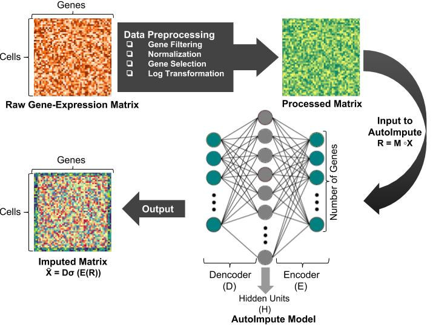

AutoImpute: Autoencoder based imputation of single cell RNA-seq data
================
Divyanshu Talwar, Aanchal Mongia, Debarka Sengupta, and Angshul Majumdar

## Introduction
`AutoImpute` is an auto-encoder based gene-expression (sparse) matrix imputation.

For detailed information refer to our paper titled "[AutoImpute : Autoencoder based imputation of single cell RNA-seq data](https://www.nature.com/articles/s41598-018-34688-x)".

-	For technical problems, please report to [Issues](https://github.com/divyanshu-talwar/AutoImpute/issues).

## Description
The input to `trainer.py` is a pre-processed count single cell matrix, with columns representing genes and rows representing cells. It's output is an imputed count matrix with the same dimension. The complete pipeline is described with the following image :

.

## Dependencies
* For Python (3):
    > numpy, scikit-learn, tensorflow, matplotlib.
* For R (pre-processing):
	> R.matlab, Matrix, ggplot2, Rtsne, svd, plyr, dplyr, data.table, mclust, flexclust, reshape2, irlba, dynamicTreeCut, RColorBrewer, GenSA, gplots

### 여기부터 설치해야 함.
install.packages("gplots")


## Contents
* `trainer.py` - is the AutoImpute imputation model.
* `data/raw` - contains the raw data in `.csv` format.
* `data/` - contains the pre-processed data in `<dataset_name>.{mat, csv}` format.
* `preprocess/` - contains the R scripts for pre-processing.

## Execution
* `AutoImpute` model can be run using the following command and command line arguments :
```bash
python3 -m auto_impute.trainer
```
_**Note:** If you use any other dataset (apart from blakeley.csv), do the necessary preprocessing using as described below, then run AutoImpute as `python3 -m auto_impute.trainer --data <dataset_name>.{mat, csv}`._

* To pre-process any dataset, place the raw data (in `.csv` format) into `AutoImpute\ Model/data/raw/` and change your directory to `AutoImpute\ Model/Pre-processing/`.
* Run the R-script `pre-process.R` using the following command:
```bash
Rscript pre-process.R <input-file-name> <dataset-name>
```
* For example, the sample dataset can be pre-processed using the following command:
```bash
Rscript pre-process.R Blakeley_raw_data.csv blakeley
Rscript pre-process.R Preimplantation_raw_data.csv preimplantation
Rscript pre-process.R Jurkat_raw_data.csv jurkat
Rscript pre-process.R Kolodziejczyk_raw_data.csv kolodziejczyk
Rscript pre-process.R Quake_raw_data.csv quake
Rscript pre-process.R Usoskin_raw_data.csv usoskin
Rscript pre-process.R Zeisel_raw_data.csv zeisel
```
